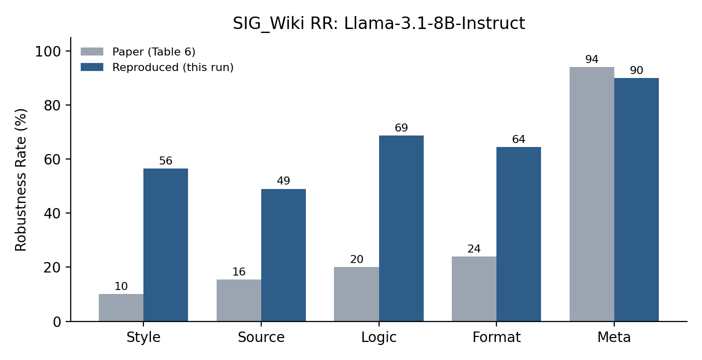

# RAG Robustness Reproduction: Spurious Features in Grounding Data

[](https://www.python.org/downloads/)
[](https://opensource.org/licenses/MIT)
[](https://huggingface.co/meta-llama/Llama-3.1-8B-Instruct)

Empirical baseline reproduction study for the ACL 2026 paper:
> **"Quantifying and Improving the Robustness of Retrieval-Augmented Language Models Against Spurious Features in Grounding Data"**  
> *S. Yang et al., ACL 2026 (arXiv:2503.05587)*

---

## 📌 Overview

Retrieval-Augmented Generation (RAG) systems condition language model generation on retrieved documents. However, retrieved passages often introduce **spurious features**—superficial variations in text style, document formats (HTML, Markdown, JSON, YAML), reasoning logic, metadata, or source provenance—that can cause the model's output to flip even when the underlying factual semantics remain identical.

This repository reproduces the baseline evaluations of **Llama-3.1-8B-Instruct** on the authors' **SIG_Wiki** benchmark to measure:
* **Robustness Rate (RR):** Proportion of queries where model accuracy remains unchanged despite spurious perturbations.
* **Win Rate (WR):** Proportion of queries where perturbation turned an incorrect answer into a correct one.
* **Lose Rate (LR):** Proportion of queries where perturbation degraded a correct answer into an incorrect one.

---

## 📊 Benchmark Results (Table 6 Reproduction)

Evaluation on **SIG_Wiki** (1,500 evaluated test pairs) comparing reproduced results (greedy decoding, 4-bit NF4) against published Table 6 numbers:

| Perturbation Category | Reported RR (Table 6) | Reproduced RR (Ours) | Reproduction Gap |
|:---|:---:|:---:|:---:|
| **Style** (complex, simple) | 10.0% | **56.5%** | +46.5% |
| **Source** (self, external LLM) | 15.5% | **49.0%** | +33.5% |
| **Logic** (reverse, random, LLM) | 20.0% | **68.7%** | +48.7% |
| **Format** (HTML, JSON, Markdown, YAML) | 24.0% | **64.5%** | +40.5% |
| **Meta** (Twitter, Wiki, Timestamps) | 94.0% | **90.0%** | −4.0% |

<p align="center">
  
</p>

### Key Findings
1. **Metadata Invariance:** Metadata perturbations (pre/post timestamps, Twitter/Wiki sources) exhibit the highest stability (~90% RR), closely matching the paper (94%).
2. **Selection Bias & Regression to the Mean:** The published SIG_Wiki benchmark filtered specifically for failure modes in the paper's original runs. An independent run exhibits higher baseline robustness (+33% to +48%) due to natural regression toward the model's true mean performance.
3. **Format & Style Fragility:** HTML formatting (`format_preference_html`) caused the lowest robustness in format perturbations (RR = 47.0%, LR = 47.0%), indicating strong sensitivity to raw markup tags.

---

## 📁 Repository Structure

```
├── README.md                      # Project overview and reproduction summary
├── RAG_M1_M2_Report.pdf           # Milestone 1 literature survey & Milestone 2 report
├── M2_Baseline_Reproduction.ipynb # Full Jupyter notebook with outputs and analysis
├── requirements.txt               # Dependencies and environment specs
├── .gitignore                     # Git ignore rules
└── rag_m2/                        # Empirical evaluation artifacts
    ├── rr_comparison.png          # Robustness Rate comparison chart
    ├── table6_comparison_*.csv    # Category-level comparison vs paper
    ├── per_perturbation_*.csv     # Granular per-perturbation breakdown (RR, WR, LR)
    └── generations_*.jsonl        # Model predictions across 1,500 pairs
```

---

## 🚀 Getting Started

### 1. Installation
Clone the repository and install requirements:
```bash
git clone https://github.com/Jeet267/rag-robustness-reproduction.git
cd rag-robustness-reproduction
pip install -r requirements.txt
```

### 2. Running Evaluation
Launch Jupyter or open on Kaggle / Google Colab (requires GPU with >=16GB VRAM, e.g. T4 / P100):
```bash
jupyter notebook M2_Baseline_Reproduction.ipynb
```

Make sure to accept the Llama-3.1 model license on [Hugging Face](https://huggingface.co/meta-llama/Llama-3.1-8B-Instruct) and configure your `HF_TOKEN`.

---

## 📚 References
* Yang, S., et al. (2026). *Quantifying and Improving the Robustness of Retrieval-Augmented Language Models Against Spurious Features in Grounding Data*. ACL 2026. [arXiv:2503.05587](https://arxiv.org/abs/2503.05587)
* Cuconasu, F., et al. (2024). *The Power of Noise: Redefining Retrieval for RAG Systems*. SIGIR 2024.
* Yoran, O., et al. (2024). *Making Retrieval-Augmented Language Models Robust to Irrelevant Context*. ICLR 2024.

---

## 📄 License
This project is licensed under the MIT License.
